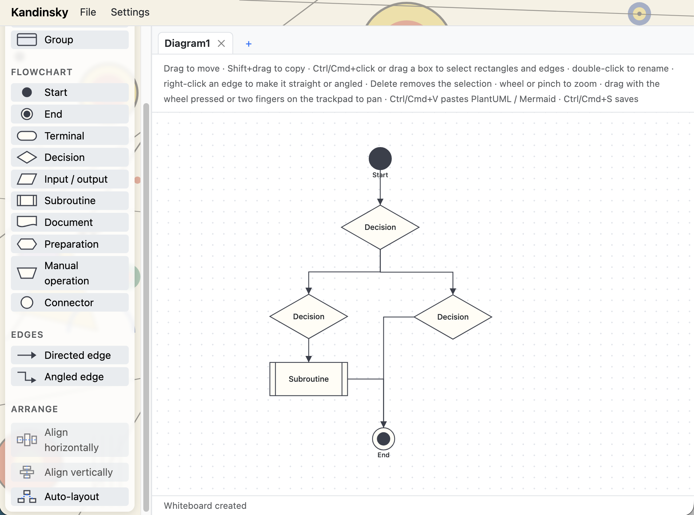

# Kandinsky

Web app for creating code UML diagrams.



- **Frontend** (`client/`): thin React client styled with Bootstrap CSS, with a header menu bar with a File drop-down (New, Open, Save, Save As, Export as SVG / PNG) and a Settings drop-down (default save format), whiteboard tabs at the top of the canvas and a left palette with shapes (rectangle, rounded, database, group), flowchart symbols (start, end, terminal, decision, input / output, subroutine, document, preparation, manual operation, connector) and edges (straight or angled).
- **Backend** (`server/`): ASP.NET Core minimal API that owns and processes the diagrams. The UI and external clients (e.g. an MCP server) use the same REST API.
- **Formats:** import and export as PlantUML or Mermaid class diagrams; Mermaid flowcharts can be imported too. Databases are PlantUML `database` elements and Mermaid `[(text)]` nodes, decisions PlantUML `hexagon` elements (`diamond` / `<>` are imported too) and Mermaid `{text}` nodes, groups PlantUML `package` blocks and Mermaid subgraphs. Flowchart symbols use Mermaid classic node shapes or the v11 shape syntax (`A@{ shape: sm-circ }`); PlantUML gets the closest element plus the exact kind in the layout comment. Mermaid export becomes a flowchart when the diagram has anything but rectangles and straight edges. Edge labels are kept in both formats; angled edges become the format's orthogonal line style when all edges are angled, else `kandinsky:edge` comments. Shape positions are kept in `kandinsky:layout` comments; files without them are auto-laid out on import.

See [REQUIREMENTS.md](REQUIREMENTS.md) for requirements, decisions and open points.

## Prerequisites

- .NET SDK 10
- Node.js 22

## Run

```sh
# backend on http://localhost:5080
cd server/Kandinsky.Server && dotnet run

# frontend on http://localhost:5180 (proxies /api to the backend; override with KANDINSKY_API_URL)
cd client && npm install && npm run dev
```

Open http://localhost:5180.

## Use

- The app opens with a new blank "Untitled" diagram (a reload keeps the open one, its id is in the URL hash).
- Every diagram on the server is a tab at the top; click a tab to switch, **+** (or **New**) creates an "Untitled" diagram, **×** deletes a diagram (asks for confirmation only if it has unsaved changes, i.e. changed since it was last saved to or opened from a file). Double-click a tab to rename the diagram in place (Enter or clicking elsewhere confirms, Esc cancels). The name is shown only on the tab. Saved files don't store the name, it is the file name: choosing a file name in the Save / Save As dialog renames the diagram to it, and opening a file names the diagram after the file (a title in the file is ignored).
- **Shapes** and **flowchart symbols** (rectangle, rounded, database, group, start, end, terminal, decision, input / output, subroutine, document, preparation, manual operation, connector): click one, then click on the canvas to place it there (Esc or clicking the tool again cancels), or drag it onto the canvas. Apart from groups they all behave like a rectangle; start and end points show their label below them.
- **Groups** are containers: a shape lying fully inside a group belongs to it (groups can be nested). Moving a shape into or out of a group changes its membership; dragging a group moves everything inside it, Shift+drag copies it with its content, and deleting a group deletes its content too. Groups are drawn behind edges and other shapes; a selection box selects a group only when it encloses the whole group. Auto-layout arranges each group's content inside it and fits the group around it.
- **Directed edge** / **Angled edge**: click one, then press on the source shape and drag onto the target (releasing elsewhere cancels); any shape, including a group, can be an endpoint. A directed edge is a straight line; an angled edge runs horizontally and vertically, leaving and entering through the middle of a side. Edges attach to diamonds at their corners; to use another corner, select the edge and drag the dot on its diamond end to the corner (the nearest corner is highlighted). Right-click an edge to switch it between straight and angled, or to return to **Automatic diamond corners**; double-click it to give it a label. The tool stays active for further edges until Esc is pressed or the tool is clicked again.
- Drag rectangles or edges to move them (dragging one of several selected objects moves them all; a selected edge carries its two rectangles along), Shift+drag to copy them (copied edges connect the copied rectangles), drag the corner handle to resize, double-click a rectangle or edge to edit its label, press Delete to remove the selection.
- **Save** opens a save dialog to choose the file location and format (PlantUML or Mermaid, with layout comments, so the file can be reopened with **Open…**); later Saves of the same whiteboard overwrite that file without asking. A whiteboard opened from a file is saved back to that file (in its format) without asking, even on the first Save. After a whiteboard is renamed, Save opens the dialog again with the new name as file name, so the old file is kept. **Save As…** always asks for a new location. Shortcuts: Ctrl+S / Cmd+S saves, Ctrl+Shift+S / Cmd+Shift+S saves as. **Settings → Default save format** selects the format offered first (default: Mermaid; stored in the browser). The dialog needs the File System Access API (Chrome, Edge); other browsers download the file in the default format instead. If the browser refuses write access to the chosen file (e.g. in embedded browsers), the file is downloaded instead and the next Save asks for a location again.
- **File → Export as SVG… / Export as PNG…** saves the whiteboard as an image, cropped to its content on a white background (PNG at 2× resolution), named after the whiteboard. Like Save, it uses the save dialog where available and downloads the file otherwise.
- Diagrams on the server live in memory; the UI no longer writes them to `server/Kandinsky.Server/data/` (the `/save` endpoint remains for API clients). Diagrams not saved to a file are lost on server restart.
- Select several rectangles and edges with Ctrl/Cmd+click or by dragging a box on the empty canvas — any rectangle or edge the box touches is selected (Ctrl/Cmd adds to the selection).
- **Align horizontally / vertically** lines up the selected rectangles on the first selected one (drawn with a thicker border); selected edges are ignored.
- **Auto-layout** arranges all rectangles in layers following the edge direction; unconnected ones go in a grid below.
- Navigate: rotate the mouse wheel or pinch on the trackpad to zoom (centered on the pointer); drag with the wheel pressed, or move two fingers on the trackpad (or touch screen), to pan.
- Changes made through the API show up in the open diagram within 2 seconds.

## REST API

OpenAPI document: http://localhost:5080/openapi/v1.json. Example requests: [Kandinsky.Server.http](server/Kandinsky.Server/Kandinsky.Server.http).

| Method | Path | Purpose |
|---|---|---|
| GET / POST | `/api/diagrams` | List / create diagrams |
| GET / PATCH / DELETE | `/api/diagrams/{id}` | Get / rename / delete a diagram |
| POST | `/api/diagrams/{id}/save` | Persist a diagram on the server (`data/`) |
| GET | `/api/diagrams/{id}/export?format=plantuml\|mermaid` | Export as text |
| POST | `/api/diagrams/import` | Create a diagram from text (`{ text, format?, name? }`) |
| POST | `/api/diagrams/{id}/align` | Align shapes (`{ shapeIds, direction: "horizontal" \| "vertical" }`) |
| POST | `/api/diagrams/{id}/layout` | Auto-layout all shapes |
| POST | `/api/diagrams/{id}/shapes` | Add a shape (`kind`: `rectangle` (default), `database`, `decision`, `group`, `start`, `end`, `terminal`, `rounded`, `io`, `subroutine`, `document`, `connector`, `preparation`, `manual`); responses include the derived `parentId` group |
| GET / PATCH / DELETE | `/api/diagrams/{id}/shapes/{shapeId}` | Get / update / delete a shape (deleting a group deletes its content) |
| POST | `/api/diagrams/{id}/edges` | Add a directed edge (`routing: "straight" \| "angled"`, default straight) |
| GET / PATCH / DELETE | `/api/diagrams/{id}/edges/{edgeId}` | Get / update / delete an edge |

Errors are returned as problem details (`application/problem+json`).

## Test

```sh
dotnet test Kandinsky.slnx
cd client && npm run build
```
